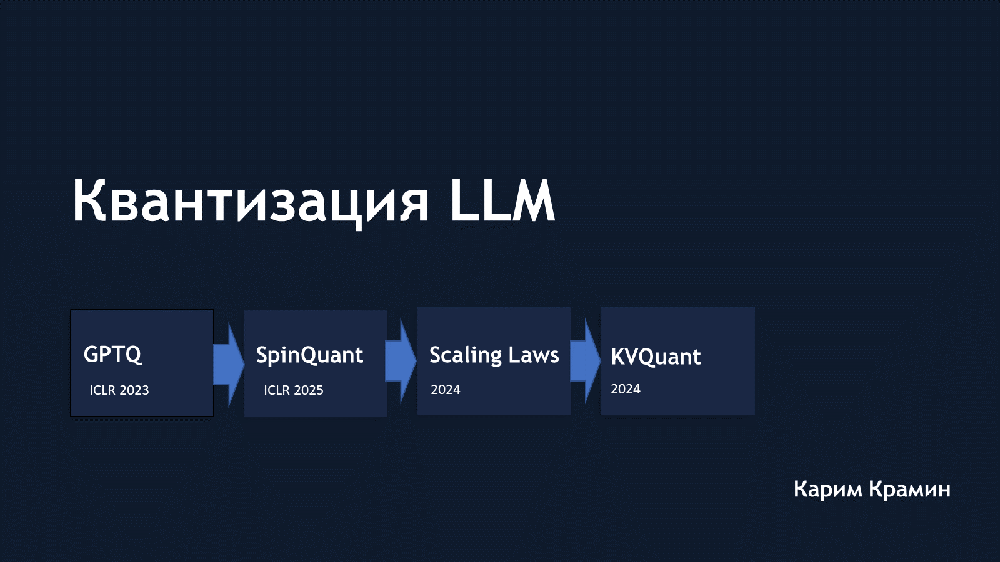

# LLM Quantization Survey

**Квантизация LLM: GPTQ, SpinQuant, Scaling Laws for Precision и KVQuant.**

Обзорный доклад о снижении точности весов, активаций и KV-кэша больших языковых моделей: математические основы методов, работа с выбросами и компромиссы между качеством, памятью и скоростью инференса.

**Автор:** Карим Крамин · **Язык:** русский · **Объём:** 24 слайда

**[Смотреть презентацию в PDF](slides/llm-quantization.pdf)** · **[Скачать PowerPoint](slides/llm-quantization.pptx)**

[](slides/llm-quantization.pdf)

## Содержание

| Слайды | Раздел | Основные вопросы |
| --- | --- | --- |
| 3-4 | Основы квантизации | Сетка квантования, обозначения W/A/KV, потребление памяти |
| 5-11 | GPTQ | Послойная реконструкция, приближение второго порядка, компенсация ошибки и ускорения алгоритма |
| 12-16 | SpinQuant | Ортогональные повороты, выбросы, обучаемые преобразования и Cayley SGD |
| 17-20 | Scaling Laws for Precision | Связь точности с масштабом модели, обучением и деградацией после квантизации |
| 21-23 | KVQuant | Поканальная квантизация ключей, Pre-RoPE, неравномерная сетка и отдельное хранение выбросов |
| 24 | Общая картина | Роль рассмотренных подходов в квантизации LLM |

## Рассматриваемые работы

1. **[GPTQ: Accurate Post-Training Quantization for Generative Pre-trained Transformers](https://arxiv.org/abs/2210.17323)** - квантизация весов после обучения с компенсацией ошибки на основе информации второго порядка.
2. **[SpinQuant: LLM Quantization with Learned Rotations](https://arxiv.org/abs/2405.16406)** - обучаемые повороты для уменьшения ошибки низкобитной квантизации.
3. **[Scaling Laws for Precision](https://arxiv.org/abs/2411.04330)** - законы масштабирования с учётом численной точности при обучении и квантизации.
4. **[KVQuant: Towards 10 Million Context Length LLM Inference with KV Cache Quantization](https://arxiv.org/abs/2401.18079)** - сжатие KV-кэша для инференса с длинным контекстом.

Доклад представляет обзор этих работ. Экспериментальные результаты и иллюстрации из статей относятся к соответствующим авторам; ссылки выше ведут к первоисточникам.

## Материалы

```text
slides/
  llm-quantization.pdf    - версия для просмотра
  llm-quantization.pptx   - исходная презентация PowerPoint
assets/
  preview.png            - обложка
```

PDF экспортирован из PowerPoint. Формулы, таблицы и оформление сохранены в исходной презентации.
